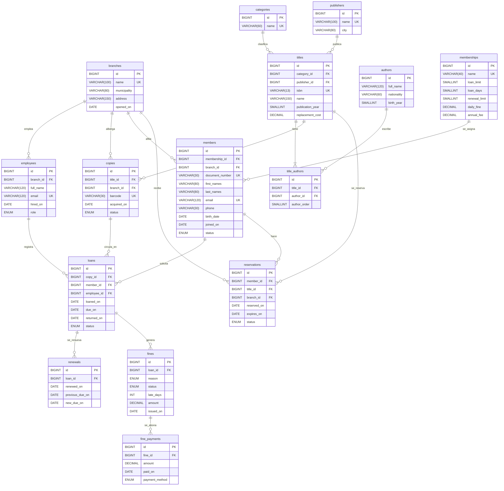

# BiblioRed

## Relaciones

- Una sede puede tener de 0 a N empleados. Cada empleado trabaja en una sola sede.
- Una categoría puede clasificar de 0 a N títulos. Cada título tiene una sola categoría.
- Una editorial puede publicar de 0 a N títulos. Cada título tiene una sola editorial.
- Un título tiene de 1 a N registros de autoría. Cada registro pertenece a un solo título.
- Un autor puede figurar en 0 a N registros de autoría. Cada registro pertenece a un solo autor.
- Un título puede tener de 0 a N ejemplares. Cada ejemplar corresponde a un solo título.
- Una sede puede guardar de 0 a N ejemplares. Cada ejemplar está en una sola sede.
- Una membresía puede tener de 0 a N socios. Cada socio tiene una sola membresía.
- Una sede puede afiliar de 0 a N socios. Cada socio se afilia en una sola sede.
- Un ejemplar puede figurar en 0 a N préstamos en su historial. Cada préstamo entrega un solo ejemplar.
- Un socio puede solicitar de 0 a N préstamos. Cada préstamo corresponde a un solo socio.
- Un empleado puede registrar de 0 a N préstamos. Cada préstamo lo registra un solo empleado.
- Un préstamo puede tener de 0 a N renovaciones, según su membresía. Cada renovación pertenece a un solo préstamo.
- Un socio puede hacer de 0 a N reservas. Cada reserva la hace un solo socio.
- Un título puede recibir de 0 a N reservas. Cada reserva corresponde a un solo título.
- Una sede puede recibir de 0 a N reservas para recogida. Cada reserva indica una sola sede de recogida.
- Un préstamo puede generar de 0 a N multas. Cada multa nace de un solo préstamo.
- Una multa puede recibir de 0 a N cuotas. Cada cuota abona una sola multa.

`title_authors` resuelve la relación N:M. Ahí va el orden porque una persona puede aparecer de primera en una obra y de segunda en otra. El par título–autor y el par título–orden son únicos. La ficha se registra junto con sus autorías. La FK por sí sola permite que un título quede temporalmente sin autor.

## Normalización

- **1FN.** Si en la ficha de *Cuentos de la Sabana* se guardaran ambos autores en una celda, tocaría partir el texto para buscar a uno. Cada autoría queda en su propia fila con su orden.
- **2FN.** En la autoría, el nombre de la persona depende solo del autor y el de la obra solo del título. Con la clave candidata `(title_id, author_id)`, el orden corresponde a la pareja. Los nombres quedan en `authors` y `titles`.
- **3FN.** Si cada socio guardara la tarifa de su membresía, al subir la de Básica habría que cambiar varios socios. La tarifa queda en `memberships` y la multa conserva el valor cobrado. El socio de una multa se obtiene por el préstamo. El saldo sale de restar los abonos al valor de la multa.
- **4FN.** Los autores y los ejemplares de una obra son listas independientes. Ya están en tablas separadas, así que agregar un ejemplar no obliga a repetir los autores.

## Reglas que requieren consultar o cambiar otros registros

- **5.** La ficha de un título debe incluir al menos una autoría.
- **10.** El vencimiento inicial usa los días de una membresía de otra tabla.
- **11.** Se consultan socio, ejemplar, multas y cantidad de préstamos activos.
- **12.** Los estados del ejemplar y del préstamo están en filas de tablas distintas.
- **14 y 15.** Renovar depende de la membresía, el préstamo, el historial y las reservas.
- **16.** Vencer una reserva depende de la fecha de corte recibida.
- **18.** La mora usa la devolución, el vencimiento y una tarifa de otra tabla.
- **19.** La pérdida actualiza dos filas y crea una multa con el costo del título.
- **20.** El saldo requiere sumar cuotas de otras filas y actualizar la multa.
