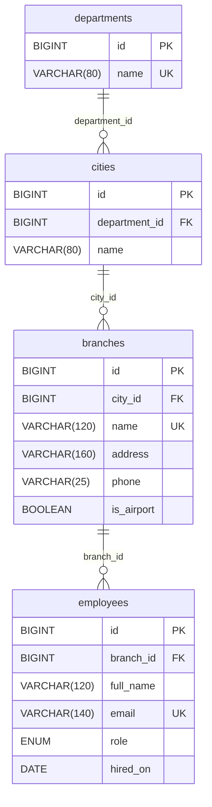
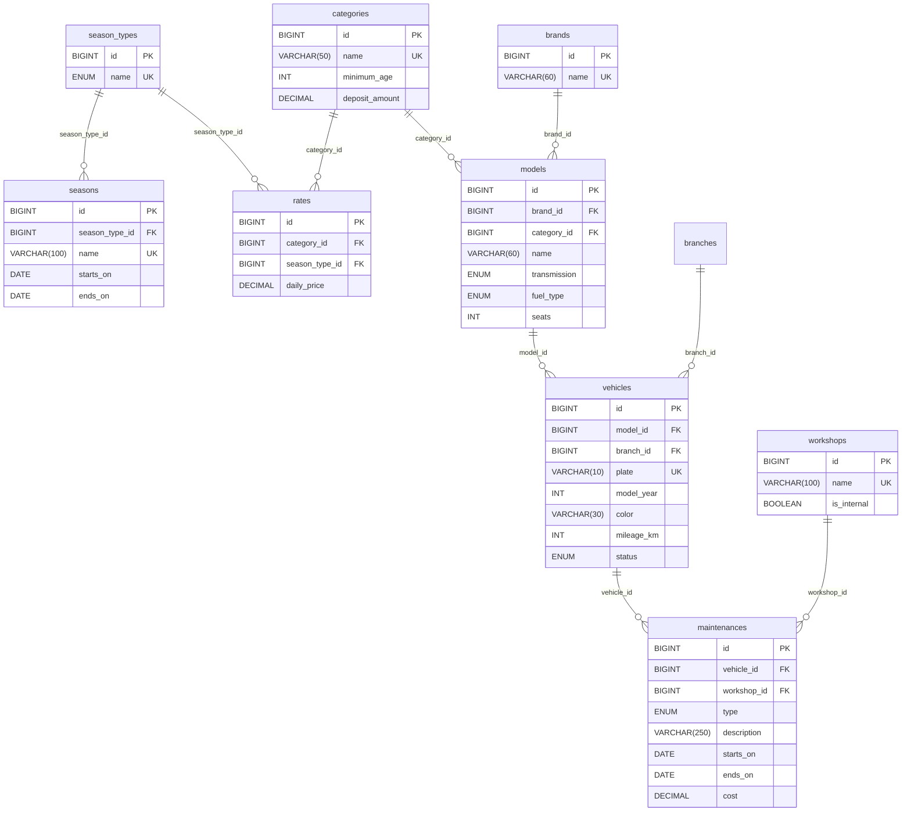
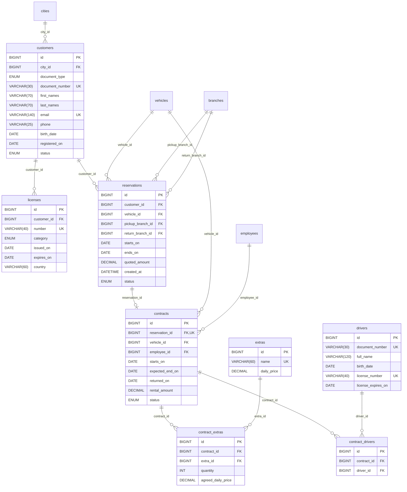
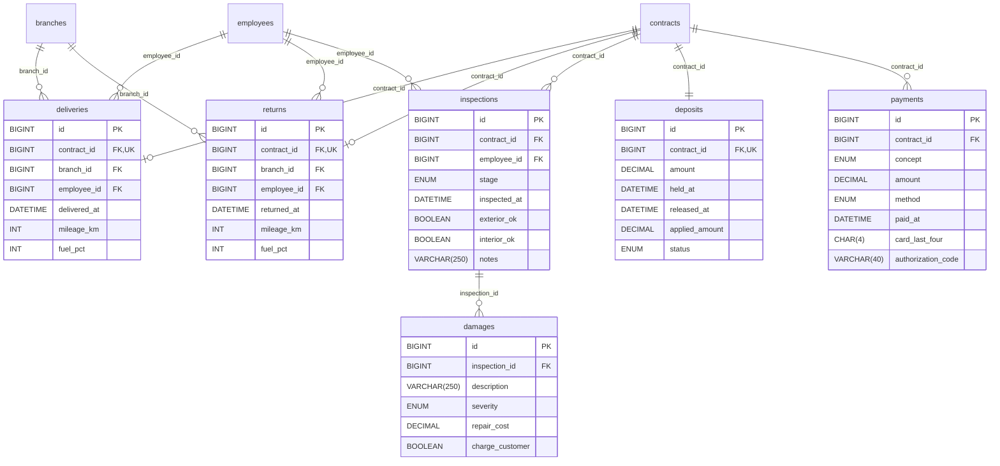

# FlotaYa

## Diagrama

### Geografía y personal

### Flota y precios

### Clientes y contratos

### Entrega y cierre

## Cardinalidades

Cada FK obligatoria apunta a un solo padre (1..1). La tabla muestra cuántos registros hijos puede tener cada padre. Las sedes de recogida y devolución son dos relaciones distintas, igual que los empleados que firman, entregan, reciben e inspeccionan.

| Padre | Hijo | Relación | Hijos por padre |
| --- | --- | --- | --- |
| departments | cities | department_id | 0..N |
| cities | branches | city_id | 0..N |
| branches | employees | branch_id | 0..N |
| season_types | seasons | season_type_id | 0..N |
| categories | rates | category_id | 0..N |
| season_types | rates | season_type_id | 0..N |
| brands | models | brand_id | 0..N |
| categories | models | category_id | 0..N |
| models | vehicles | model_id | 0..N |
| branches | vehicles | branch_id | 0..N |
| vehicles | maintenances | vehicle_id | 0..N |
| workshops | maintenances | workshop_id | 0..N |
| cities | customers | city_id | 0..N |
| customers | licenses | customer_id | 0..N |
| customers | reservations | customer_id | 0..N |
| vehicles | reservations | vehicle_id | 0..N |
| branches | reservations | pickup_branch_id | 0..N |
| branches | reservations | return_branch_id | 0..N |
| reservations | contracts | reservation_id | 0..1 |
| vehicles | contracts | vehicle_id | 0..N |
| employees | contracts | employee_id | 0..N |
| contracts | contract_extras | contract_id | 0..N |
| extras | contract_extras | extra_id | 0..N |
| contracts | contract_drivers | contract_id | 0..N |
| drivers | contract_drivers | driver_id | 0..N |
| contracts | deliveries | contract_id | 0..1 |
| branches | deliveries | branch_id | 0..N |
| employees | deliveries | employee_id | 0..N |
| contracts | returns | contract_id | 0..1 |
| branches | returns | branch_id | 0..N |
| employees | returns | employee_id | 0..N |
| contracts | inspections | contract_id | 0..N |
| employees | inspections | employee_id | 0..N |
| inspections | damages | inspection_id | 0..N |
| contracts | deposits | contract_id | 1..1 |
| contracts | payments | contract_id | 0..N |

El depósito es obligatorio para cada contrato según el negocio. UNIQUE evita duplicarlo y la FK impide un depósito huérfano. La obligación de crear el depósito al registrar el contrato requiere completar ambas operaciones juntas.

## Tablas puente

- `rates` relaciona categorías y tipos de temporada. Guarda la tarifa diaria y permite una sola fila por pareja.
- `contract_extras` relaciona contratos y extras. Guarda la cantidad y el precio diario pactado.
- `contract_drivers` relaciona contratos y conductores adicionales. La misma pareja no se puede repetir.

## Normalización

- **1FN.** Guardar “GPS, dos sillas, seguro” en una celda complica contar los extras. Cada extra queda en una fila de `contract_extras`, con su cantidad.
- **2FN.** En la pareja contrato–extra, el nombre del extra depende solo del extra. Por eso el nombre y el precio de lista quedan en `extras`. La cantidad y el precio pactado dependen de la pareja.
- **3FN.** Si cada vehículo tuviera copiada la edad mínima de su categoría, un cambio obligaría a editar varios carros. Ese dato queda en `categories`. La ciudad y su departamento también se guardan separados.
- **4FN.** Los extras y los conductores de un contrato son listas independientes. Al separarlas en dos tablas puente se evita repetir cada extra por cada conductor.

## Preguntas guía

1. La reserva guarda lo solicitado y cotizado. El contrato registra el alquiler que sí se realizó. Una reserva cancelada se conserva sin contrato, y el cliente del contrato se obtiene desde su reserva.
2. El precio pactado se guarda en `contract_extras.agreed_daily_price`. El precio de lista puede subir y el contrato anterior conserva su valor.
3. Se guardan 18 tarifas, una por cada pareja de las 6 categorías y los 3 tipos. Las 10 temporadas usan esas tarifas por su tipo.
4. La edad mínima y el depósito pertenecen a la categoría. Copiarlos en cada modelo o vehículo produciría valores distintos si se actualizan unas filas y otras quedan pendientes.
5. La reserva usa `pickup_branch_id` y `return_branch_id`. Entregas y devoluciones tienen sus propias relaciones con sede y empleado. Cada línea lleva el nombre de la FK para distinguirlas.
6. El daño pertenece a la inspección. La etapa indica si apareció en la entrega o en la devolución. Los daños previos quedan marcados como no cobrables.
7. Cada licencia ocupa una fila de `licenses`, así se conserva la vencida y la vigente. Los conductores adicionales tienen su propia tabla y pueden participar en varios contratos.
8. Se guardan nacimiento, fechas, cotización, precios pactados, pagos y el alquiler al cerrar. La edad, las noches y el saldo se calculan con esos datos. La cotización conserva lo que se ofreció al reservar.

## Reglas y restricciones

| Regla | ¿Se protege con la estructura? | Cómo o por qué |
| --- | --- | --- |
| 6 | En parte | CHECK valida el orden de las fechas. Los huecos y cruces requieren comparar temporadas entre sí. |
| 8 | No | Sumar las noches requiere consultar temporadas y tarifas. Lo hace fn_valor_alquiler. |
| 9 | En parte | CHECK valida fechas y costos vacíos de un trabajo en curso. Cambiar el estado del vehículo requiere otra tabla. |
| 14 | No | Para detectar un cruce se consultan las demás reservas del vehículo. |
| 15 | No | Se consultan cliente, categoría, vehículo y licencias. Lo valida sp_crear_reserva. |
| 20 | En parte | CHECK evita costos negativos. Para impedir cobrar un daño previo hay que consultar la etapa de su inspección. El cierre solo suma daños de devolución. |
| 21 | En parte | UNIQUE permite un depósito por contrato y CHECK limita el valor aplicado. La existencia del depósito y su importe según la categoría requieren consultar otras tablas. |
| 23 | No | El cierre modifica contrato, depósito, pagos y vehículo dentro de la transacción del llamador. |

El calendario de las semillas cubre del 2025-12-15 al 2027-01-15. El valor por defecto de creación de una reserva usa CURRENT_TIMESTAMP por la regla 13. Las semillas y las pruebas dan fechas fijas, incluida la fecha de creación usada por el procedimiento.
